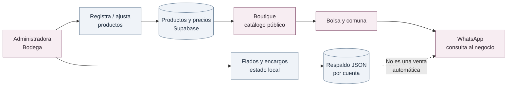
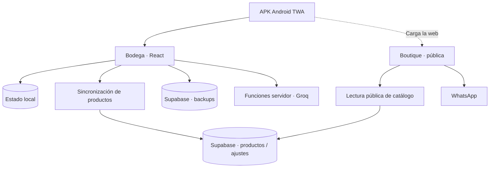

<div align="center">

<picture>
  <source media="(prefers-color-scheme: dark)" srcset="branding/banners/PaMaRa_AyN_banner_oscuro.png" />
  
</picture>

# PaMaRa Bodega

**Un lugar para ordenar lo que ocurre detrás del mostrador.**

*PaMaRa AyN es el negocio de mi mamá. PaMaRa Bodega es la aplicación que desarrollé para acompañar su trabajo.*

[](docs/general/02-alcance-y-funciones.md)
[](docs/tecnica/03-persistencia-y-sincronizacion.md)
[](LICENSING.md)
[](https://github.com/NicoCG32/Bodega-PaMaRa/actions/workflows/calidad.yml)

[**Ver la Boutique**](https://pamara-bodega.lovable.app/) · [**Entrar a Bodega**](https://pamara-bodega.lovable.app/bodega) · [**Documentación**](docs/README.md) · [**Versiones Android**](https://github.com/NicoCG32/Bodega-PaMaRa/releases)

</div>

---

## Por qué lo hice

En PaMaRa AyN se venden principalmente perfumes y también otros productos. Entre encargos, fiados, abonos y existencias, quería que mi mamá pudiera revisar todo desde su teléfono sin depender de conversaciones antiguas o de recordar cada movimiento.

Por eso separé dos experiencias: **Bodega**, donde la administradora registra y corrige, y **Boutique**, donde una persona puede explorar el catálogo y preparar una consulta por WhatsApp. La IA ayuda a interpretar voz, texto o fotografías, pero **no debería guardar una operación sin revisión humana**.

## Dos experiencias, un mismo inventario

| **Bodega · administración** | **Boutique · consulta pública** |
| --- | --- |
| Registrar fiados, abonos, cuotas y encargos | Explorar perfumes y otros productos publicados |
| Contar y ajustar existencias, por formulario o captura asistida | Revisar precio calculado, stock y disponibilidad |
| Definir precios y decidir qué producto se muestra | Preparar una bolsa con productos y cantidades |
| Utilizar una sesión autorizada para sincronizar productos y respaldos | Abrir WhatsApp con un mensaje de pedido ya redactado |

La **Boutique no procesa pagos ni confirma ventas**. La comuna se incluye en la consulta, pero el costo de entrega se acuerda fuera de la aplicación: **no existe un cotizador de despacho implementado**.

<details>
<summary><strong>Ver el recorrido del negocio</strong></summary>



Los pedidos que llegan por WhatsApp se atienden fuera del sistema y se registran separadamente en Bodega. [Flujos de uso](docs/general/02-alcance-y-funciones.md).

</details>

## Estado real del proyecto

| Estado | Qué representa actualmente |
| --- | --- |
| **Implementado en código** | Web con Bodega protegida por sesión y rol, inventario y precios en tablas Supabase, respaldos JSON por cuenta, Boutique pública, WhatsApp y captura asistida por Groq |
| **En validación** | Operación diaria en teléfonos, conflictos de sincronización, seguridad del alta de administrador, permisos de notificaciones y funcionamiento de APK Android beta |
| **Propuesto o no acreditado** | Cálculo de tarifas de entrega, pedidos confirmados dentro de la web, sincronización sin conflictos entre varios administradores y funcionamiento independiente de la red |

**Implementado** significa que existe una ruta o función comprobable en el repositorio; **no implica** que todas las integraciones estén configuradas ni que se hayan validado en condiciones reales.

<details>
<summary><strong>¿Qué se sincroniza y qué sigue siendo una limitación?</strong></summary>

- **Productos y precios:** se leen/escriben en tablas compartidas (`productos` y `ajustes_tienda`) y la aplicación usa Realtime para detectar cambios.
- **Fiados, encargos y teléfonos:** forman parte de un estado local en `localStorage`; con sesión se respalda como **snapshot JSON** en `backups`.
- **Conflictos:** la restauración del snapshot completo puede sobrescribir cambios; el flujo de productos tampoco es una edición concurrente transaccional demostrada.
- **Visibilidad:** la Boutique solo debe consultar productos publicados; los campos de cobros y teléfonos no pertenecen a su respuesta.
- **Android:** la APK TWA abre la web alojada. No contiene un backend ni una aplicación de inventario autónoma sin conexión.

[Modelo de datos](docs/tecnica/03-persistencia-y-sincronizacion.md) · [Seguridad y riesgos](docs/tecnica/05-boutique-y-seguridad.md).

</details>

## Tecnología y estructura

| Pieza | Implementación |
| --- | --- |
| Interfaz | React 19, TypeScript, TanStack Start, Vite y Tailwind CSS |
| Reglas | `src/lib/store.ts`, proyección de Boutique y lógica de movimientos |
| Estado local | `localStorage` para el trabajo de la administradora |
| Nube | Supabase Auth/PostgreSQL: `productos`, `ajustes_tienda`, `backups`, `push_tokens` y `user_roles` |
| Captura asistida | Groq con transcripción, interpretación y análisis de fotografías; confirmación humana |
| Distribución | Web con servidor y Android **beta** mediante Trusted Web Activity |

<details>
<summary><strong>Explorar el mapa de arquitectura</strong></summary>



[Arquitectura completa por niveles](docs/tecnica/01-arquitectura.md) · [Modelo del dominio y estados](docs/tecnica/02-dominio-y-reglas.md).

</details>

## Ejecutar y comprobar

Con Bun, el backend y las variables de entorno correspondientes configuradas:

```bash
bun install --frozen-lockfile
bun run dev
```

```bash
bun run lint
bunx tsc --noEmit
bun run test
bun run build
```

La ejecución local requiere configurar el proveedor de autenticación y Supabase; **no** copies credenciales reales al repositorio. [Entorno de desarrollo](docs/desarrollo/01-desarrollo-local.md) · [Validación Android](docs/android-acceptance.md).

## Para seguir leyendo

| Si buscas… | Comienza aquí |
| --- | --- |
| **Conocer la idea y cómo usarla** | [General](docs/general/01-origen-y-proposito.md) → [Funciones y límites](docs/general/02-alcance-y-funciones.md) |
| **Entender cómo está construida** | [Arquitectura](docs/tecnica/01-arquitectura.md) → [Persistencia](docs/tecnica/03-persistencia-y-sincronizacion.md) |
| **Revisar o continuar el desarrollo** | [Pruebas](docs/desarrollo/03-pruebas-y-limitaciones.md) → [Evolución](docs/desarrollo/04-evolucion.md) |
| **Revisar autoría y permisos** | [Licencias y recursos](docs/desarrollo/05-licencias-y-recursos.md) · [LICENSING.md](LICENSING.md) |

[**Índice completo y rutas de lectura**](docs/README.md) · [**Identidad de PaMaRa AyN**](branding/README.md)

## Autoría y uso

PaMaRa Bodega es el **software que desarrollé para apoyar el negocio familiar**. **PaMaRa AyN** es el nombre y la identidad del emprendimiento de mi mamá; no debe confundirse el software con la titularidad comercial de esa marca.

El código y la documentación sobre los que se pueden conceder derechos usan [PolyForm Noncommercial 1.0.0](LICENSE). Consulta [LICENSING.md](LICENSING.md), [NOTICE](NOTICE) y el [inventario de recursos pendientes de atribución](docs/desarrollo/05-licencias-y-recursos.md) antes de reutilizar o distribuir materiales. Esta documentación no modifica los permisos vigentes.
