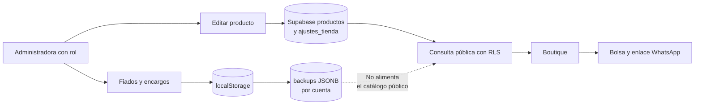

# Documentación · PaMaRa Bodega

**La experiencia del negocio, las decisiones del código y la evidencia de lo que está listo.**

[**Portada**](../README.md) · [**Boutique**](https://pamara-bodega.lovable.app/) · [**Bodega**](https://pamara-bodega.lovable.app/bodega) · [**Limitaciones actuales**](desarrollo/03-pruebas-y-limitaciones.md)

---

## Áreas de documentación

| Recorrido           | Para quién                                                         | Por dónde empezar                                                                                        |
| ------------------- | ------------------------------------------------------------------ | -------------------------------------------------------------------------------------------------------- |
| **01 · General**    | Quien quiere comprender el negocio y las dos experiencias          | [Origen](general/01-origen-y-proposito.md) · [Funciones](general/02-alcance-y-funciones.md)              |
| **02 · Técnica**    | Quien necesita comprender datos, reglas, seguridad e integraciones | [Arquitectura](tecnica/01-arquitectura.md) · [Persistencia](tecnica/03-persistencia-y-sincronizacion.md) |
| **03 · Desarrollo** | Quien mantiene, prueba o distribuye el software                    | [Entorno](desarrollo/01-desarrollo-local.md) · [Pruebas](desarrollo/03-pruebas-y-limitaciones.md)        |

> **Acceso acordado:** la **Boutique es pública** para consultar productos y abrir WhatsApp sin registrarse. La **Bodega es privada** para la administración familiar autorizada. El repositorio se pretende privado, pero actualmente sigue visible en GitHub; la licencia no cambia su visibilidad.

> **Lectura técnica:** la Boutique obtiene productos y precios de tablas compartidas de Supabase. Los fiados, encargos y teléfonos viven en el estado local y pueden respaldarse como JSON por cuenta.

## 01 · General — por qué existe

- [**Origen, personas y propósito**](general/01-origen-y-proposito.md): PaMaRa AyN es el negocio familiar; Bodega es la herramienta informática.
- [**Funciones, límites y flujos**](general/02-alcance-y-funciones.md): administración, boutique, WhatsApp y qué no automatiza.
- [**Identidad, interacción y accesibilidad**](general/03-experiencia-e-identidad.md): estética metálica, móvil y recursos gráficos.

## 02 · Técnica — de la interfaz a la persistencia

| Capítulo                                                                     | Qué comprueba                                                                |
| ---------------------------------------------------------------------------- | ---------------------------------------------------------------------------- |
| [Arquitectura por niveles](tecnica/01-arquitectura.md)                       | Contexto, contenedores, componentes, despliegue y fronteras de confianza     |
| [Dominio y reglas](tecnica/02-dominio-y-reglas.md)                           | Fiados, stock, encargos, precios y máquinas de estados                       |
| [Persistencia y sincronización](tecnica/03-persistencia-y-sincronizacion.md) | Tablas físicas reales, RLS, JSONB y Realtime frente a respaldo completo      |
| [Captura de voz, texto y fotografías](tecnica/04-captura-e-ia.md)            | Modelos Groq realmente integrados, secuencias y revisión humana              |
| [Boutique, visibilidad y seguridad](tecnica/05-boutique-y-seguridad.md)      | Productos públicos, rol administrador, exposición de datos y puntos críticos |
| [Notificaciones](tecnica/06-notificaciones.md)                               | Avisos locales, FCM, cron y qué debe comprobarse en dispositivo              |

<strong>Ver el flujo esencial del catálogo</strong>

[Ver límites de sincronización y seguridad](tecnica/03-persistencia-y-sincronizacion.md).

## 03 · Desarrollo — reproducir y validar

- [**Preparación local**](desarrollo/01-desarrollo-local.md) — Bun, Node, variables y fuentes de código.
- [**Web y Android TWA**](desarrollo/02-android-y-despliegue.md) — firma, versión beta y distribución.
- [**Pruebas, riesgos y límites**](desarrollo/03-pruebas-y-limitaciones.md) — automatizadas frente a aceptación real.
- [**Evolución del proyecto**](desarrollo/04-evolucion.md) — mejoras pendientes, no características ya entregadas.
- [**Licencias, marca y recursos**](desarrollo/05-licencias-y-recursos.md) — licencia actual, terceros y atribuciones por comprobar.
- [**Aceptación de Android**](android-acceptance.md) — checklist para instalar y actualizar sin perder los datos.

## Interpretar el estado correctamente

**Implementado**: hay código y una ruta identificable. **En validación**: falta evidencia reproducible en uso real, dispositivos o servicios externos. **Propuesto**: es una aspiración que **no** debe describirse como una capacidad disponible.

En especial, la configuración de Firebase, de las tareas cron y del certificado Android no queda demostrada por la existencia de archivos de código. Se revisa contra el despliegue.
