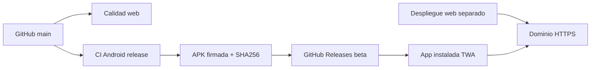

# Despliegue web y distribución Android

## Dos entregas, un mismo producto

La web vive en `https://pamara-bodega.lovable.app/`, usa TanStack Start y servicios configurados en el entorno alojado. El cliente Android usa **Trusted Web Activity** para abrir ese origen en un navegador compatible. El `launchUrl` de la APK apunta a `/` (**Boutique**); la PWA instalada desde el navegador inicia en `/bodega`, según `manifest.webmanifest`. No incluye una copia independiente del servidor ni un almacén SQLite de los datos.



La web debe desplegarse para cambiar el comportamiento de una instalación existente; el APK empaqueta el acceso y la identidad Android. Si la web no responde, la TWA tampoco puede operar normalmente.

## Configuración existente

Según `android/release.properties` y archivos Gradle:

- Identificador: `app.lovable.pamara_bodega`.
- Versión base: `0.1.0-beta.1` en el archivo local; CI genera identificadores de prerelease crecientes.
- Android mínimo API **26**, objetivo y compilación API **36**.
- JDK **21**; Android SDK / Build Tools **36.0.0**.
- Se necesita un navegador compatible con Trusted Web Activity / Custom Tabs.

## Construir para prueba

Con JDK 21, Android SDK y sus paquetes indicados:

```bash
cd android
./gradlew assembleDebug lintDebug
```

En Windows PowerShell: `./gradlew.bat assembleDebug lintDebug`. Los builds release necesitan un keystore y las variables **`ANDROID_KEYSTORE_PATH`**, **`ANDROID_KEYSTORE_PASSWORD`**, **`ANDROID_KEY_ALIAS`** y **`ANDROID_KEY_PASSWORD`**. No deben agregarse al repositorio.

Desde la raíz hay comprobaciones de release:

```bash
node --test scripts/android-release.test.mjs
node scripts/android-release.mjs --inspect-web
```

El empaquetador inspecciona el APK, la firma, identidad, versión y asociación del dominio, y escribe artefactos en `release-output/`. La revisión de HTTPS/asset links y la firma de la APK deben validarse con la versión concreta que se distribuye.

## GitHub Actions

- `calidad.yml`: lint, tipos, pruebas, build web y prueba del empaquetador.
- `android-check.yml`: compila y ejecuta lint Android en cambios pertinentes.
- `android-release.yml`: **se ejecuta con cada push a `main`**, incluso cambios sólo de documentación, y publica una **prerelease beta** si los secretos y controles están disponibles. Es independiente del despliegue web.

La automatización asigna `versionCode` como `1000 + GITHUB_RUN_NUMBER`. Las releases se publican en canal beta.

## Asociación y actualizaciones

`public/.well-known/assetlinks.json` declara la asociación del dominio con el certificado Android. Debe servirse por HTTPS y coincidir con el paquete/firma; también es necesaria la comprobación de Android en el dispositivo. Si la asociación falla, puede aparecer una barra de navegador.

La actualización exige mismo identificador de paquete, firma compatible y un código de versión mayor. Guardar el keystore de firma y contraseñas fuera del repositorio. **No desinstalar** para simular una actualización: desinstalar o borrar datos del navegador puede afectar el estado local.

## Archivos de la release

Una release beta debería adjuntar APK, `SHA256SUMS.txt`, manifiesto de procedencia, notas y avisos de licencia. Antes de invitar a utilizarla, ejecutar el checklist con cuenta de prueba, dispositivo real y fecha registrada.

[Lista de aceptación Android](../android-acceptance.md) · [Arquitectura](../tecnica/01-arquitectura.md)
