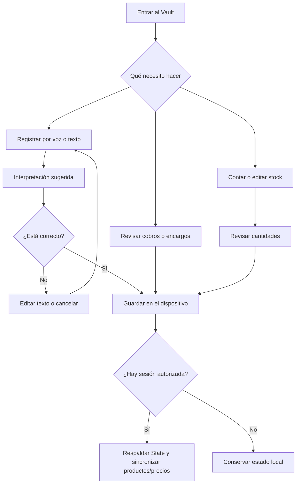
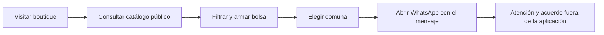

# Qué hace PaMaRa Bodega

La aplicación se divide en **Boutique**, **pública sin registro para clientes**, y **Bodega/Vault**, **privada para la familia autorizada**, que requiere Google y el rol `admin`. Las rutas antiguas (`/vault`, `/catalogo`, etc.) redirigen a `/bodega/*`. Que el catálogo esté abierto al público no permite consultar cobros, contactos ni respaldos.

| Área      | Funciones                                                                    | Condición o límite                                                                                              |
| --------- | ---------------------------------------------------------------------------- | --------------------------------------------------------------------------------------------------------------- |
| Cobros    | Fiados, abonos, cuotas, saldo, pendientes y resumen mensual                  | No es contabilidad formal; depende de los datos registrados.                                                    |
| Encargos  | Crear, consultar, marcar entregado y eliminar                                | Un pedido enviado por WhatsApp **no crea** un encargo de forma automática.                                      |
| Bodega    | Productos, stock, precios, recuento por voz/foto y sugerencias de reposición | La captura por IA exige revisión; stock y precios se sincronizan además con tablas compartidas.                 |
| Precios   | Precio base, recargo por encargo y descuento por liquidación                 | Montos fijos configurables, sin cálculo de impuestos o costos reales de entrega.                                |
| Boutique  | Filtrar catálogo, preparar bolsa y abrir WhatsApp                            | Consulta productos visibles en `productos` y precios en `ajustes_tienda`; no procesa pagos ni reserva unidades. |
| Promoción | Crear collages, copiar anuncios y generar prompts de tendencias             | Los collages se descargan o comparten desde el teléfono; la aplicación no publica por sí sola en redes.          |
| Nube      | Inicio con Google, copia del estado y recuperación                           | El snapshot JSON completo no resuelve conflictos; productos y precios usan un flujo compartido distinto.        |
| Avisos    | Aviso local con la aplicación abierta; registro web push y trabajo de cron   | La entrega con app cerrada requiere configuración FCM y pruebas externas.                                       |
| Android   | APK beta TWA                                                                 | Carga la web; necesita internet, dominio disponible y navegador compatible.                                     |

## Flujo de quien administra

## Flujo de quien compra

La bolsa calcula el total de los productos. La comuna se incluye en el mensaje y el costo de despacho se acuerda por WhatsApp. Las etiquetas de disponibilidad orientan la consulta; la tienda confirma el plazo de entrega.

## Collages y presentaciones

La Boutique muestra cuatro presentaciones de frasco y estuche, y cada ficha de perfume incluye la correspondiente. Las imágenes de inspiración del catálogo se mantienen separadas de estas fotografías.

En Bodega, **Crear un collage** permite elegir de uno a seis perfumes publicados y preparar dos imágenes: una cuadrada para publicaciones (1080 × 1080) y otra vertical para estados (1080 × 1920). El título y el mensaje son editables; el mensaje inicial es «A pedido · Consulta por WhatsApp». Los precios están ocultos al comenzar y, al activarlos, se aplica la misma regla de precios que en la Boutique. Los frascos y estuches correspondientes también se pueden incluir u ocultar.

Tras generar las imágenes, se puede revisar cada formato y guardarlo como JPEG. En teléfonos con uso compartido de archivos aparece también **Compartir imagen**. La composición se hace en el navegador con las referencias existentes del catálogo, sin subir imágenes ni cambiar el inventario. Los productos marcados como privados quedan fuera de la selección.

## Alcance actual

El pago y la coordinación de entrega ocurren fuera de la aplicación. La gestión está pensada para un negocio con una administradora. La sincronización de productos/precios existe, pero falta validar conflictos entre dispositivos; varias tiendas necesitarían una separación explícita de datos y roles.

[Reglas exactas](../tecnica/02-dominio-y-reglas.md) · [Seguridad del catálogo](../tecnica/05-boutique-y-seguridad.md)
