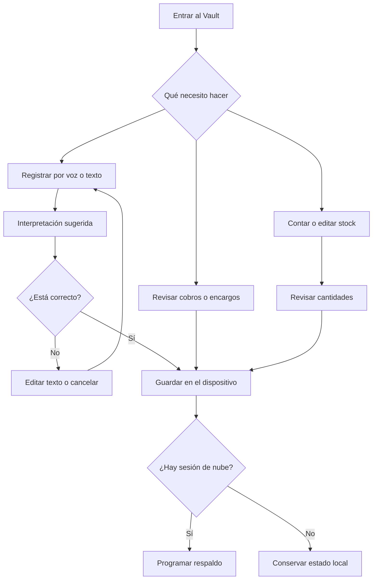
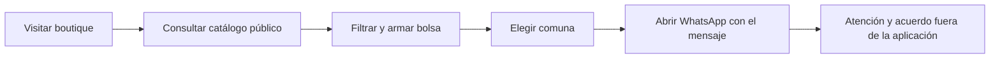

# Qué hace PaMaRa Bodega

La aplicación se divide en **Boutique**, que cualquiera puede consultar, y **Vault**, pensado para administrar el negocio desde el teléfono.

| Área      | Funciones                                                                    | Condición o límite                                                               |
| --------- | ---------------------------------------------------------------------------- | -------------------------------------------------------------------------------- |
| Cobros    | Fiados, abonos, cuotas, saldo, pendientes y resumen mensual                  | No es contabilidad formal; depende de los datos registrados.                     |
| Encargos  | Crear, consultar, marcar entregado y eliminar                                | Un pedido enviado por WhatsApp **no crea** un encargo de forma automática.       |
| Bodega    | Productos, stock, precios, recuento por voz/foto y sugerencias de reposición | La captura por IA exige revisión; el stock se guarda en estado local.            |
| Precios   | Precio base, recargo por encargo y descuento por liquidación                 | Montos fijos configurables, sin cálculo de impuestos o costos reales de entrega. |
| Boutique  | Filtrar catálogo, preparar bolsa y abrir WhatsApp                            | Muestra el último respaldo disponible; no procesa pagos ni reserva unidades.     |
| Promoción | Copiar anuncios y generar prompts de tendencias                              | No publica en Facebook ni genera automáticamente una imagen.                     |
| Nube      | Inicio con Google, copia del estado y recuperación                           | La sincronización de snapshot completo no resuelve edición simultánea.           |
| Avisos    | Aviso local con la aplicación abierta; registro web push y trabajo de cron   | La entrega con app cerrada requiere configuración FCM y pruebas externas.        |
| Android   | APK beta TWA                                                                 | Carga la web; necesita internet, dominio disponible y navegador compatible.      |

## Flujo de quien administra

## Flujo de quien compra

La bolsa calcula el total de los productos. La comuna se incluye en el mensaje y el costo de despacho se acuerda por WhatsApp. Las etiquetas de disponibilidad orientan la consulta; la tienda confirma el plazo de entrega.

## Alcance actual

El pago y la coordinación de entrega ocurren fuera de la aplicación. La gestión está pensada para un negocio con una administradora; la edición simultánea y el soporte de varias tiendas requieren ampliar la arquitectura.

[Reglas exactas](../tecnica/02-dominio-y-reglas.md) · [Seguridad del catálogo](../tecnica/05-boutique-y-seguridad.md)
