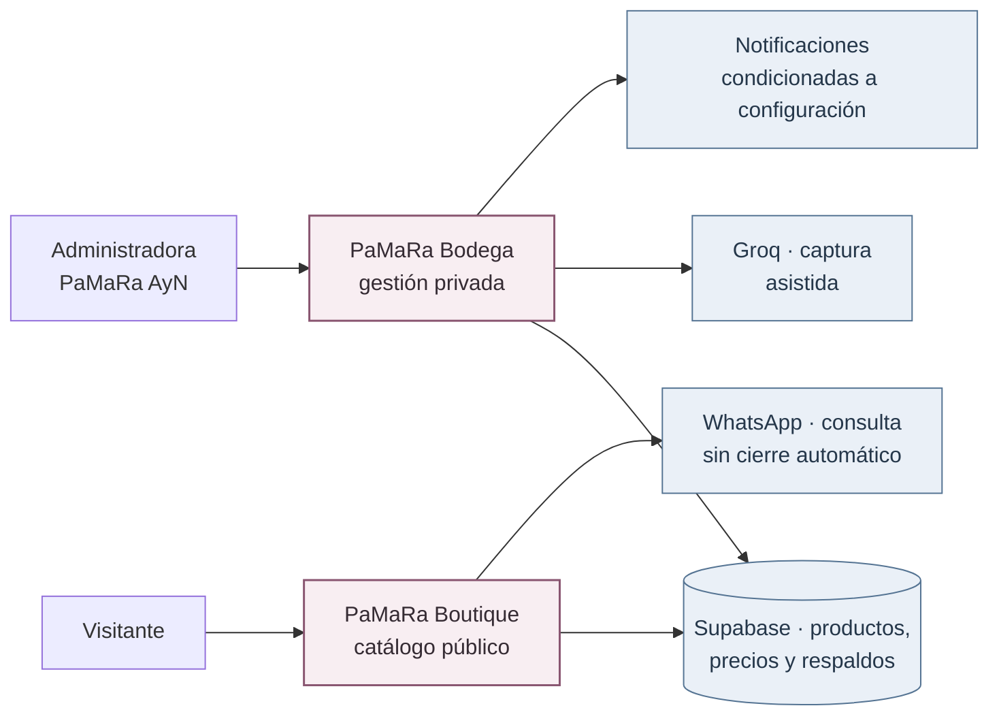
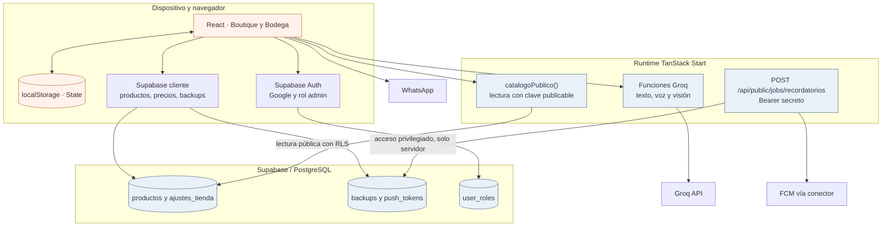
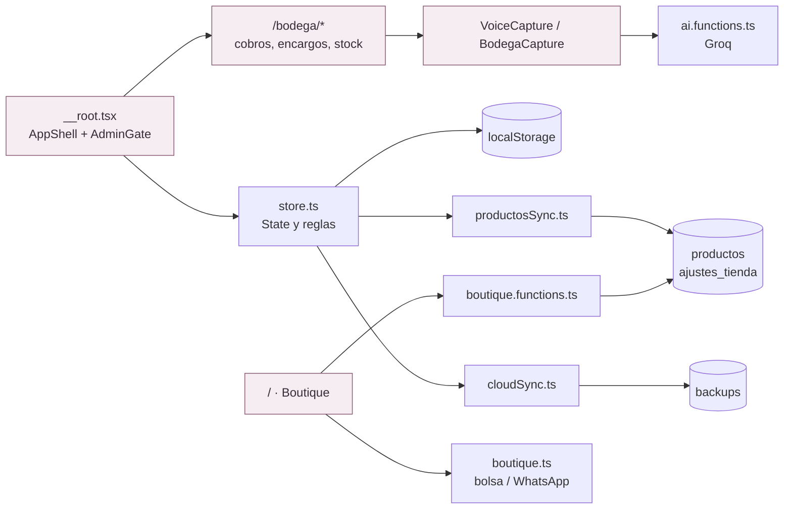
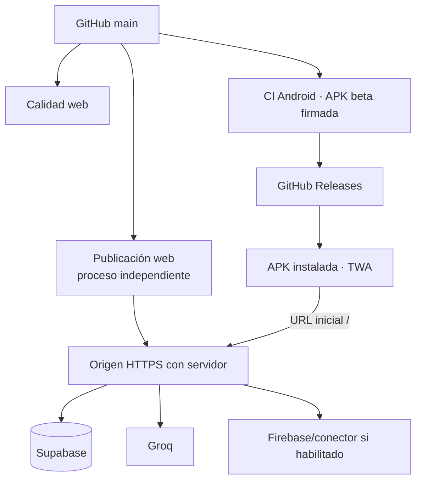

# Arquitectura · del negocio a los servicios

[← Técnica](../README.md) · [Dominio](02-dominio-y-reglas.md) · [Datos](03-persistencia-y-sincronizacion.md) · [Seguridad](05-boutique-y-seguridad.md)

PaMaRa Bodega combina **administración privada y catálogo público**, pero no los guarda de la misma forma. El modelo técnico actual tiene **tablas compartidas de productos y precios**, un **respaldo JSON por cuenta** para el resto del estado y una **copia local** para la experiencia en el dispositivo.

> **Alcance de esta auditoría:** los diagramas representan código y migraciones del repositorio. No prueban por sí solos que los permisos, credenciales y proveedores estén configurados del mismo modo en un entorno publicado.

## C1 · Contexto del sistema

**PaMaRa AyN** es el emprendimiento familiar. **Bodega** es el software que lo apoya; la Boutique pública es una interfaz de consulta del mismo producto informático.

## C2 · Contenedores y límites de confianza

**No confundir:**

- La Boutique pública obtiene `data` de **`productos`**, restringidos por `en_boutique = true` y la política RLS; también lee `ajustes_tienda`. **No consulta el respaldo global más reciente.**
- Bodega solicita sesión Google y rol **`admin`** a través de `AdminGate.tsx` y `has_role`. No usa un PIN local como autorización principal.
- `backups` guarda deudas, encargos, teléfonos y el estado completo **de la cuenta autenticada**. No es la tabla del catálogo.
- `productosSync.ts` y `cloudSync.ts` son procesos diferentes que interactúan con el mismo `State` local; su concurrencia necesita pruebas.
- Las funciones Groq tienen clave privada de servidor y validaciones de entrada. **Disponer de una clave no equivale a autorización por usuario**; sus restricciones deben revisarse antes de ampliar el uso.

## C3 · Componentes y responsabilidades

| Componente | Código | Responsabilidad |
| --- | --- | --- |
| Entrada y autorización | [`__root.tsx`](../../src/routes/__root.tsx), [`AdminGate.tsx`](../../src/components/AdminGate.tsx) | Composición de rutas, sesión y rol administrador |
| Estado operativo | [`store.ts`](../../src/lib/store.ts) | Fiados, abonos, stock, encargos y reglas de precios |
| Inventario compartido | [`productosSync.ts`](../../src/lib/productosSync.ts) | Sincronizar productos/precios y recibir eventos Realtime |
| Respaldo por cuenta | [`cloudSync.ts`](../../src/lib/cloudSync.ts) | Subir o restaurar snapshot JSON completo |
| Boutique | [`boutique.functions.ts`](../../src/lib/boutique.functions.ts), [`boutique.ts`](../../src/lib/boutique.ts) | Lectura pública controlada, precio, filtros y mensaje de pedido |
| Asistencia | [`ai.functions.ts`](../../src/lib/ai.functions.ts) | Audio, interpretación y visión mediante Groq |
| Notificaciones | [`recordatorios.ts`](../../src/routes/api/public/jobs/recordatorios.ts) | Procesamiento programado y envío condicionado a FCM |

## C4 · Despliegue y distribución

La APK usa **Trusted Web Activity** y su `launchUrl` apunta a la raíz **`/`**, es decir, a la **Boutique**. Las rutas anteriores `/vault`, `/cobros`, etc. redirigen a `/bodega/*` según su implementación. **No** se incluye un inventario Android con base autónoma ni un backend integrado en el APK.

El workflow de Android prepara una prerelease con cada push a `main`, si dispone de secretos de firma y supera sus controles. La publicación web es un proceso distinto. [Distribución Android](../desarrollo/02-android-y-despliegue.md).

## Decisiones que requieren atención

- **Administración:** la migración `0001_productos_y_admin.sql` asigna automáticamente el rol `admin` al primer usuario creado cuando no existe otro. **Es una decisión de inicialización sensible** que debe verificarse en el entorno real antes de abrir un alta de cuentas.
- **Protección de datos:** las políticas RLS protegen tablas, pero `catalogoPublico()` y las funciones con privilegios siguen necesitando revisión de entradas y salida.
- **Sincronización:** los cambios compartidos de productos y el respaldo integral local pueden confluir; no se ha probado una garantía general de ausencia de conflictos.
- **Operación:** las notificaciones cerradas requieren Firebase, un programador externo y pruebas con el teléfono.

[Persistencia y tablas reales](03-persistencia-y-sincronizacion.md) · [Seguridad de Boutique](05-boutique-y-seguridad.md) · [Pruebas](../desarrollo/03-pruebas-y-limitaciones.md).
