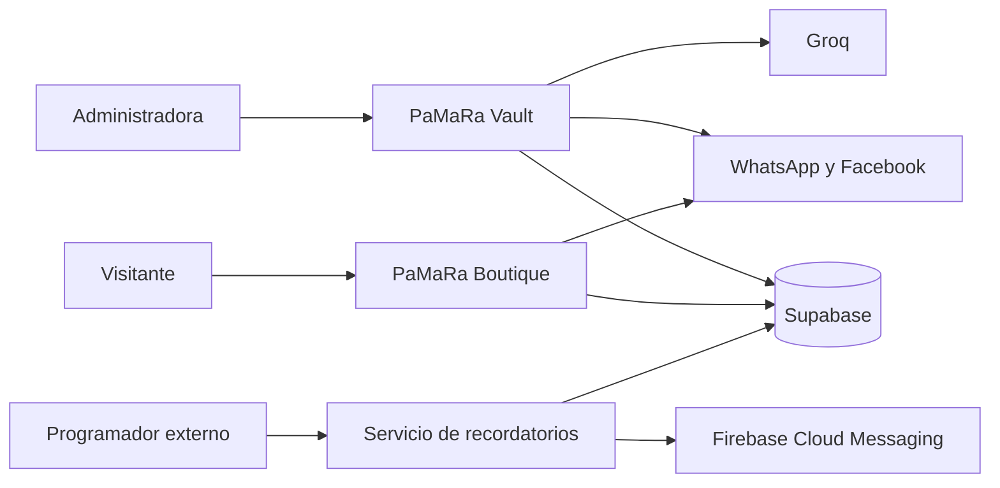
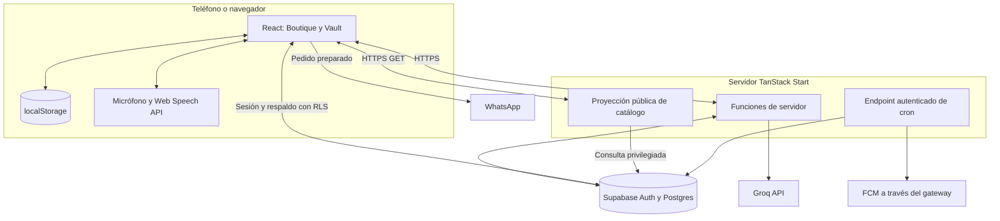
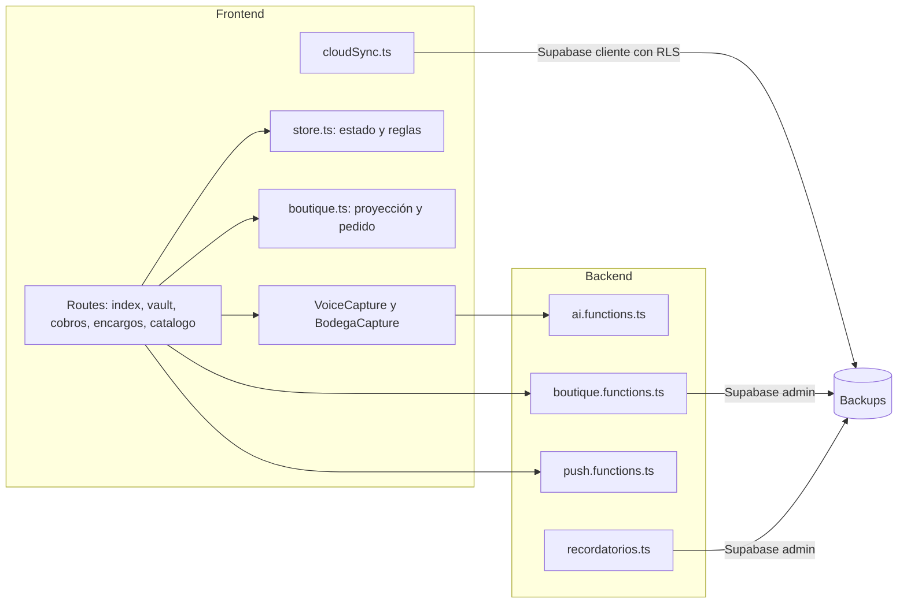
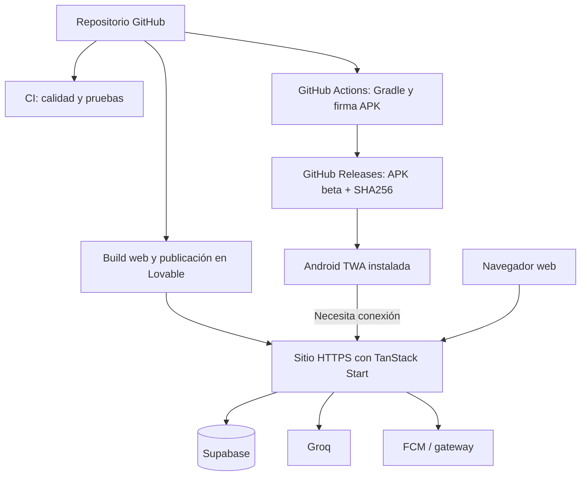

# Arquitectura · de la persona al código

PaMaRa Bodega es una aplicación **web con servidor**, estado local y servicios externos. El APK Android abre el sitio publicado mediante una Trusted Web Activity.

## Nivel 1 · Contexto

**Límites:** los clientes de la boutique no deben ver deudas ni teléfonos; el servicio Groq procesa sólo lo enviado a sus funciones; la entrega de mensajes de WhatsApp ocurre fuera del sistema.

## Nivel 2 · Contenedores y ejecución

`localStorage` pertenece al origen y perfil del navegador. El servidor ejecuta las funciones de IA, consulta pública del catálogo y recordatorios.

## Nivel 3 · Componentes del proyecto

| Responsabilidad            | Archivo principal                                                                                  | Función                                                               |
| -------------------------- | -------------------------------------------------------------------------------------------------- | --------------------------------------------------------------------- |
| Estado y reglas            | [`store.ts`](../../src/lib/store.ts)                                                               | Deudas, cuotas, abonos, productos, encargos y precios.                |
| Captura y validación de IA | [`ai.functions.ts`](../../src/lib/ai.functions.ts)                                                 | Funciones servidor, validación con Zod, Groq.                         |
| Dictado alternativo        | [`vozNativa.ts`](../../src/lib/vozNativa.ts)                                                       | Web Speech y transcripción grabada concurrentes.                      |
| Respaldo                   | [`cloudSync.ts`](../../src/lib/cloudSync.ts)                                                       | Snapshot completo por cuenta y temporizador de subida.                |
| Vista pública              | [`boutique.functions.ts`](../../src/lib/boutique.functions.ts)                                     | Lee `backups` y convierte productos en `ItemPublico`.                 |
| Protección de rutas        | [`__root.tsx`](../../src/routes/__root.tsx), [`AdminGate.tsx`](../../src/components/AdminGate.tsx) | Separación visual y PIN **del lado cliente**.                         |
| Notificaciones             | [`recordatorios.ts`](../../src/routes/api/public/jobs/recordatorios.ts)                            | Trabajo HTTP protegido por secreto, lectura de snapshots y envío FCM. |

Las reglas de precios, saldos y existencias están en `store.ts`; los componentes coordinan la captura y confirmación de operaciones.

## Nivel 4 · Despliegue

La web y el APK se publican por separado. El workflow Android genera una beta con **cada push a `main`**, incluidos los cambios de documentación.

## Decisiones y consecuencias

- **Snapshot frente a tablas normalizadas:** simplifica respaldar un negocio de una administradora, pero complica conflictos y consulta de un historial transaccional.
- **IA como propuesta:** facilita registrar narraciones, pero requiere confirmar montos, códigos y cantidades.
- **TWA frente a app nativa:** conserva el servidor y el OAuth web, a costa de depender de la conectividad y del navegador.
- **Catálogo derivado de backups:** evita duplicar inventarios, pero debe fijarse la cuenta propietaria y revisar qué productos se publican por defecto.

[Modelo y estados](02-dominio-y-reglas.md) · [Persistencia](03-persistencia-y-sincronizacion.md) · [Pruebas](../desarrollo/03-pruebas-y-limitaciones.md)
