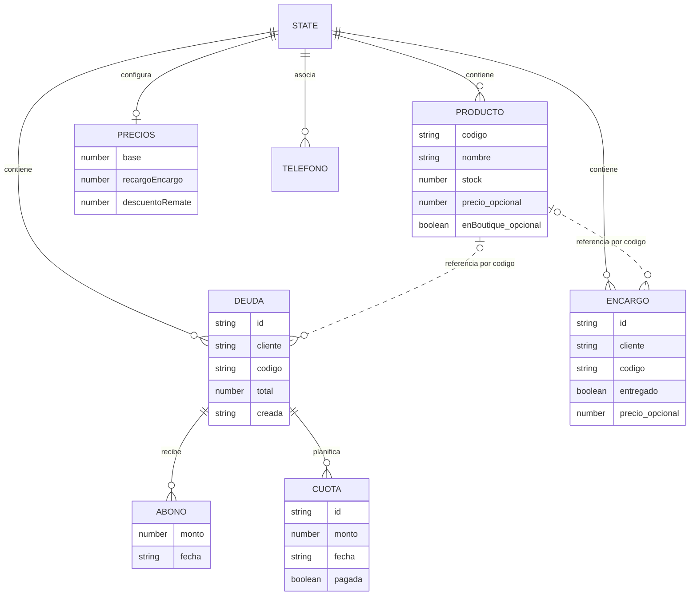
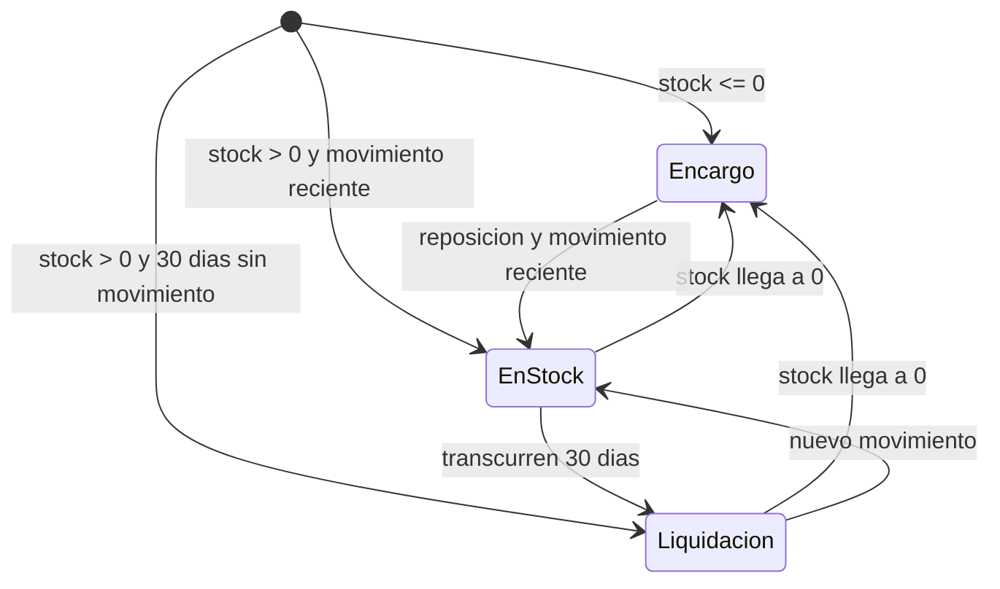
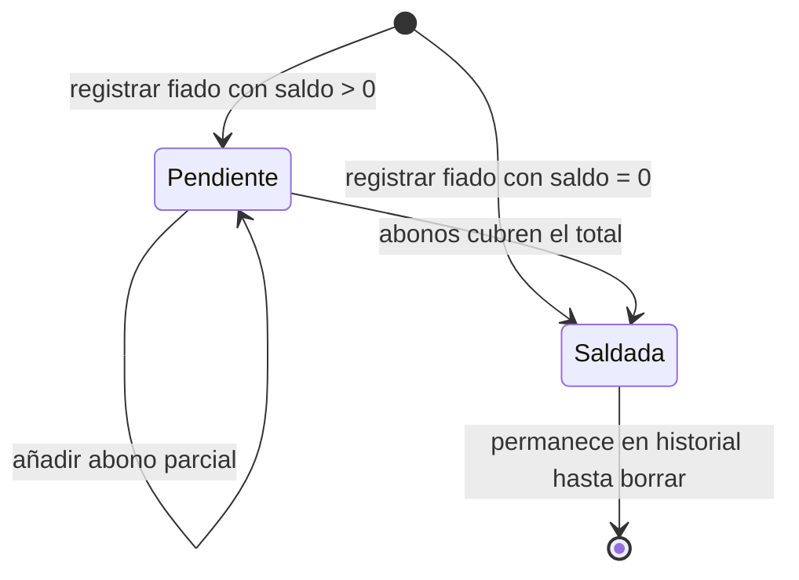
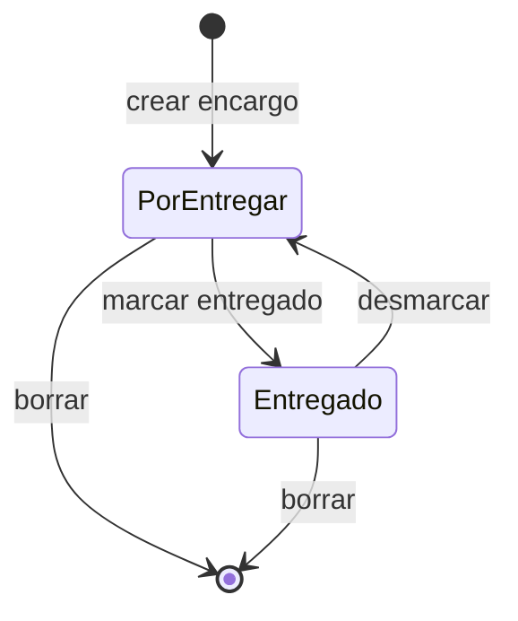

# Dominio y reglas de negocio

El núcleo de PaMaRa Bodega es el `State` de [`src/lib/store.ts`](../../src/lib/store.ts). Las entidades de este capítulo son **objetos del estado local**, no un esquema SQL físico. Sin embargo, productos y precios **también** existen en las tablas reales `productos` y `ajustes_tienda`; cobros, encargos y teléfonos se respaldan en `backups.data`. El dominio nace de operaciones concretas: recibir mercadería, vender fiado, abonar, entregar un encargo y consultar disponibilidad.

## Modelo de dominio

**Lectura del diagrama:** el enlace a Producto se realiza mediante código, no mediante clave foránea. `telefonos` es un diccionario `cliente → teléfono`; no existe una entidad Cliente normalizada con identificador propio. `Precios` es opcional en el objeto persistido: se usan valores iniciales si aún no está configurado.

## Reglas ejecutadas

| Regla              | Implementación                                                                                                                            |
| ------------------ | ----------------------------------------------------------------------------------------------------------------------------------------- |
| Saldo de deuda     | `max(0, total - suma(abonos.monto))`.                                                                                                     |
| Cuotas             | Se ordenan por fecha y se marcan pagadas cuando el total abonado cubre la secuencia; una cuota pendiente no es un abono.                  |
| Códigos            | `normCodigo()` reconoce `H`, `M`, `T`; convierte `F` → `M` y `J` → `T` y completa al menos dos dígitos.                                   |
| Existencias        | `ajustarStock()` aplica `max(0, stock + delta)`. Una entrada registra `fechaIngreso` en ciertos casos; una salida registra `ultimaVenta`. |
| Reposición         | Producto sin stock con encargo pendiente o venta registrada dentro de los 30 días previos.                                                |
| Liquidación        | Stock positivo y 30 días o más sin movimiento según fechas disponibles.                                                                   |
| Precio propio      | `p.precio || cfg.base`; si el precio del producto es 0 se aplica el precio base. |
| Estado sin stock   | Precio base + recargo por encargo.                                                                                                        |
| Estado liquidación | `max(0, base - cfg.descuentoRemate)`.                                                                                                     |
| Estado normal      | Precio base sin ajuste.                                                                                                                   |

Los valores iniciales son **$15.000 CLP** (base), **+$2.000** (encargo) y **−$3.000** (liquidación). Se pueden cambiar desde Ajustes y, con sesión de administradora, sincronizar en `ajustes_tienda`.

## Estado calculado de un producto

No hay un campo persistido para `estado` en el producto: se **calcula** al consultar el precio. Si faltan fechas de movimiento, `diasQuieto()` devuelve 0, por lo que no se declara liquidación de manera automática.

## Estados de cobros y encargos

El saldo determina si una deuda está pendiente o saldada. El encargo conserva el indicador `entregado`, que se puede marcar o desmarcar. Ambos registros se pueden eliminar.

## Consideraciones al modificar operaciones

- `actions.abonar()` agrega el monto recibido; el flujo que lo llama debe comprobar que sea positivo y corresponda al saldo.
- Una venta fiada por voz reduce una unidad de stock si hay código, **aunque el dictado haya indicado otra cantidad**; es el comportamiento actual de `VoiceCapture.guardar()`.
- `upsertProducto()` reemplaza el objeto completo que coincide en código; un formulario debe preservar campos opcionales para no perder opciones como `enBoutique`.
- `uid()` genera identificadores locales con `Math.random()`.
- Los días se calculan usando `hoy()` con fecha derivada de `toISOString()` (UTC); probar el límite de día según hora de Chile.

Los productos y precios se sincronizan desde `productosSync.ts` a tablas SQL; la representación de `State` no debe confundirse con la persistencia física.

[IA y confirmación](04-captura-e-ia.md) · [Persistencia real](03-persistencia-y-sincronizacion.md)
