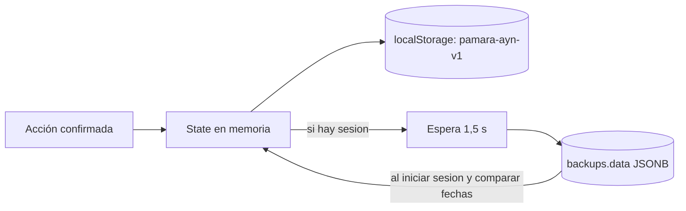
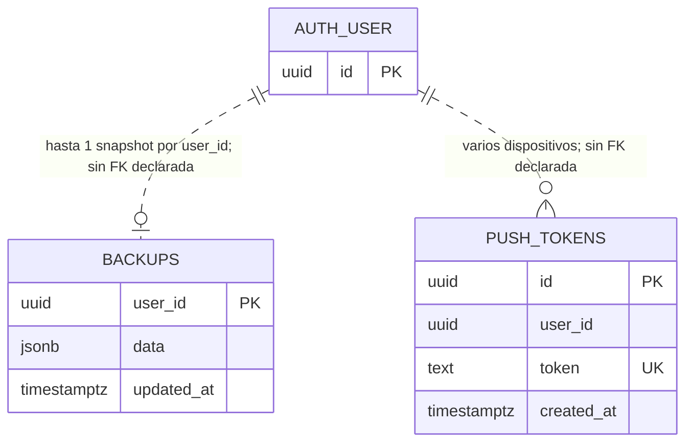
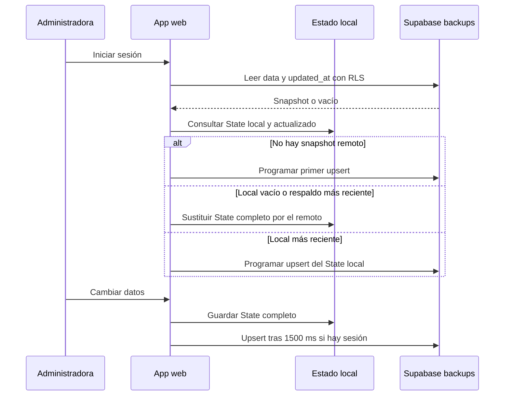
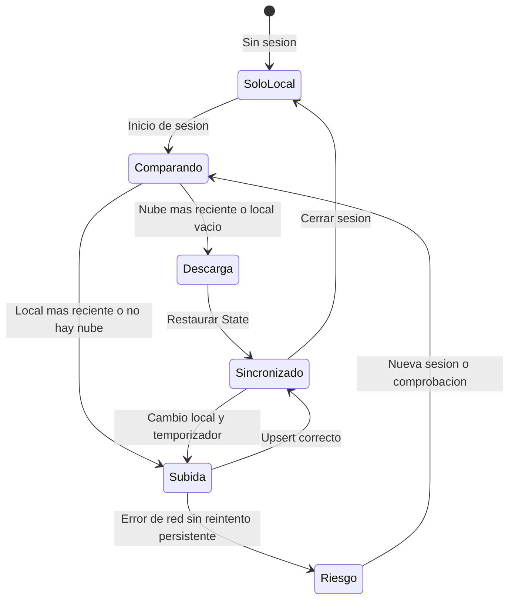

# Datos y sincronización

## Dos capas, dos objetivos

La aplicación trabaja primero contra **`localStorage`** bajo la clave `pamara-ayn-v1`. Allí guarda un `State` completo con deudas, encargos, productos, teléfonos, precios opcionales y `actualizado`. El catálogo base de perfumes se agrega en la carga con stock cero, sin modificar el stock que la persona ya registró.

Cuando la administradora inicia sesión, [`cloudSync.ts`](../../src/lib/cloudSync.ts) conecta ese estado con un único **snapshot JSON** en Supabase para el usuario autenticado. No hay tablas SQL `productos`, `deudas`, `abonos` ni `encargos`.



## Esquema relacional físico existente



`AUTH_USER` representa conceptualmente una cuenta de Supabase Auth; **no es una tabla creada por la migración**. Las líneas punteadas son asociaciones por `user_id`: el SQL de `drizzle/migrations/0000_create_backups_and_push_tokens.sql` **no declara claves foráneas**. La única restricción de unicidad adicional relevante es `push_tokens.token`.

Las dos tablas tienen **Row Level Security** activado. Sus políticas de lectura y escritura para el rol `authenticated` exigen `auth.uid() = user_id`. El servidor utiliza un cliente privilegiado para la boutique y el trabajo de recordatorios, lo que obliga a controlar la selección y exposición desde el propio código de servidor.

## El contenido de `backups.data`

```text
State
├── deudas[]
│   ├── id, cliente, codigo, total, creada
│   ├── abonos[]: monto, fecha
│   └── cuotas[]: id, monto, fecha, pagada
├── encargos[]: id, cliente, codigo, nota, entregado, creada, precio?
├── productos[]: codigo, nombre, stock, tipo?, inspiracion?, version?,
│                 categoria?, precio?, fechaIngreso?, ultimaVenta?, enBoutique?
├── telefonos: { nombreCliente: numero }
├── precios?: { base, recargoEncargo, descuentoRemate }
└── actualizado: fecha ISO
```

La copia incluye información personal de cobros y teléfonos. No debe publicarse como fixture, JSON de ejemplo real ni payload de diagnóstico.

## Sincronización por cuenta · secuencia real



En la comparación, `updated_at` de Supabase y `State.actualizado` son tiempos ISO; no hay versión de esquema ni fusión campo a campo. Además, `conCatalogo()` agrega productos de referencia al cargar, por lo que “sin productos” no es una señal fiable de un estado originalmente vacío.

## Estado del respaldo



La sincronización reemplaza el estado completo y carece de fusión entre dispositivos o reintentos persistentes. **Un snapshot puede reemplazar cambios hechos en otro equipo**; conviene terminar el respaldo antes de cambiar de dispositivo.

## Recuperación responsable

1. Guardar una copia de prueba con datos sintéticos y anotar fecha y cuenta.
2. Modificar un registro en otro perfil/dispositivo de prueba y comparar resultado.
3. Verificar explícitamente qué versión prevalece después de iniciar sesión.
4. No limpiar los datos del navegador original hasta comprobar que la copia esté disponible.

[Seguridad y boutique](05-boutique-y-seguridad.md) · [Migración SQL](../../drizzle/migrations/0000_create_backups_and_push_tokens.sql) · [Referencia de RLS en Supabase](https://supabase.com/docs/guides/database/postgres/row-level-security)
