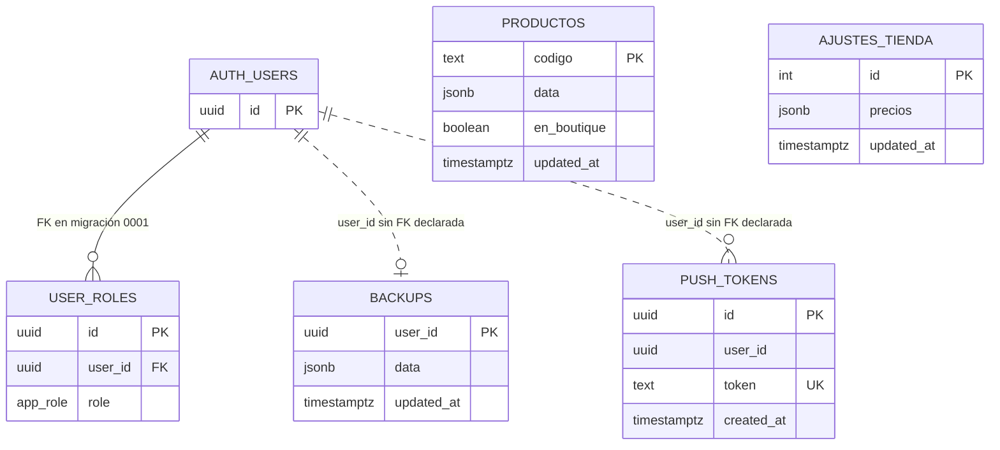
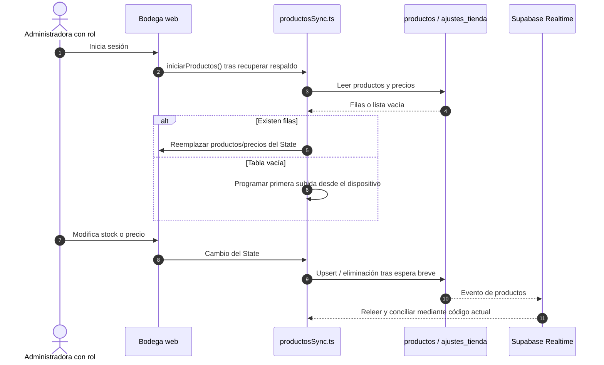
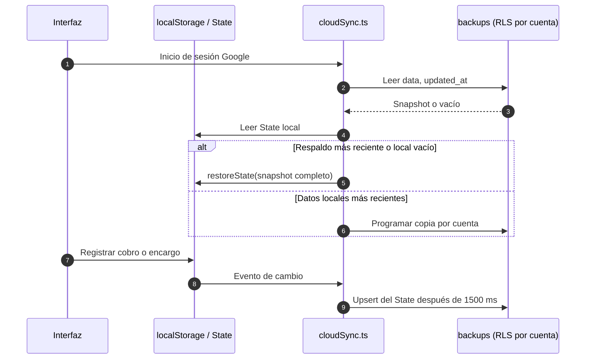
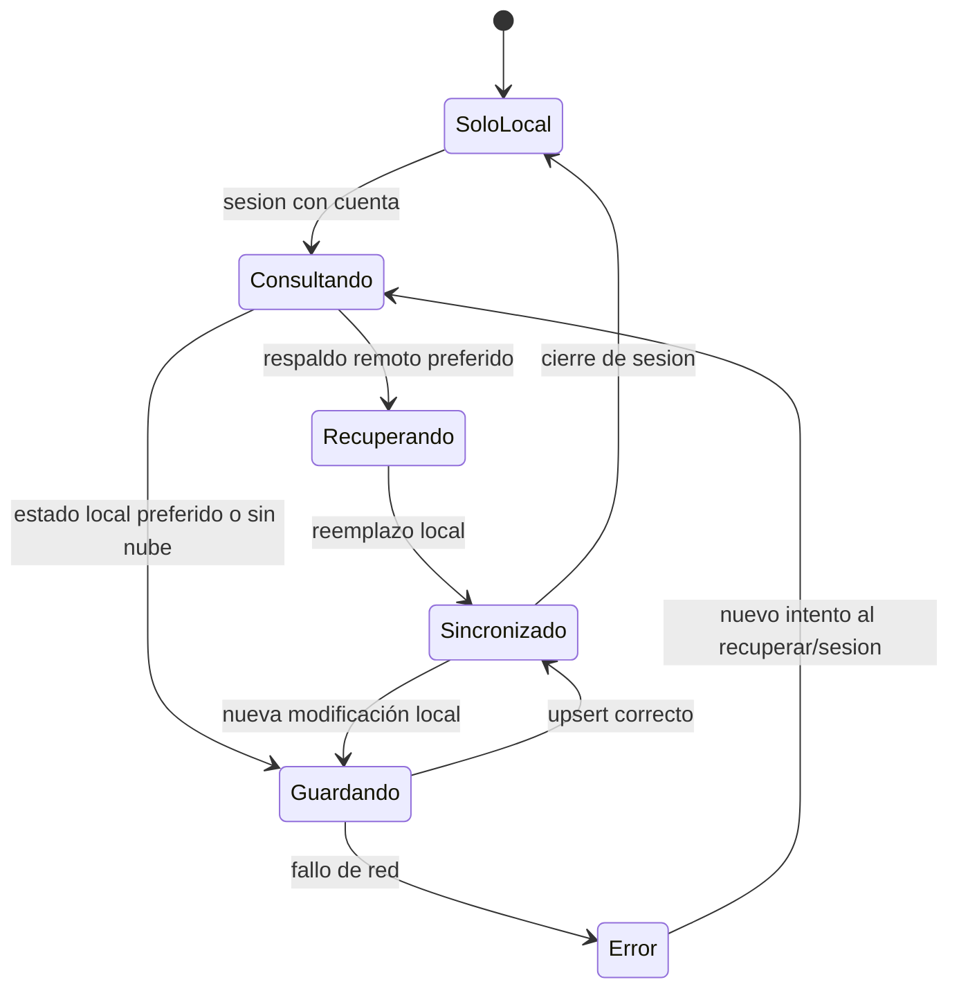

# Persistencia · productos compartidos y respaldo por cuenta

[← Técnica](../README.md) · [Arquitectura](01-arquitectura.md) · [Boutique y seguridad](05-boutique-y-seguridad.md)

El modelo actual tiene **tres responsabilidades distintas**. Separarlas evita explicar erróneamente la Boutique como una copia del último respaldo global.

## Qué vive dónde

| Almacenamiento | Contenido | A quién sirve |
| --- | --- | --- |
| **`localStorage`** (`pamara-ayn-v1`) | `State` con deudas, abonos, cuotas, encargos, teléfonos, productos, precios y `actualizado` | Estado de trabajo del dispositivo |
| **`productos` y `ajustes_tienda`** (PostgreSQL) | Productos en JSONB, marca `en_boutique`, precios compartidos | Administración autorizada y catálogo público |
| **`backups`** (PostgreSQL) | Snapshot JSONB del estado completo, ligado a `user_id` | Recuperación de cobros, encargos, teléfonos y otros campos |
| **`push_tokens` y `user_roles`** (PostgreSQL) | Tokens de dispositivo y rol `admin` | Avisos, control de acceso e inicialización |

Las migraciones `0000` y `0001` son la fuente del esquema físico. `drizzle/schema.ts` no sustituye estas migraciones como referencia de todas las tablas, roles y políticas.

## Modelo físico SQL documentado

`AUTH_USERS` representa **conceptualmente** `auth.users`: no se crea como una tabla de negocio en las migraciones del repositorio. Solo `user_roles.user_id` declara una clave foránea a esa tabla de Auth. Las líneas punteadas son referencias **lógicas**, no FK. `productos` y `ajustes_tienda` no tienen FK entre sí; son catálogos/ajustes compartidos.

## 1. Productos y precios compartidos

`src/lib/productosSync.ts` compara los objetos por código y JSON, espera **800 ms** antes de guardar y recibe eventos de `productos` con una nueva consulta programada a **1500 ms**. **Esto no constituye una estrategia de resolución robusta de conflictos concurrentes**: los cambios en dos dispositivos deben probarse antes de prometer sincronización sin pérdidas.

Los precios de `ajustes_tienda` son un registro global con `id = 1`, y `productos` usa `codigo` como clave primaria. La columna `en_boutique` permite filtrar la lectura pública por RLS; el objeto `data` contiene atributos del producto, no cobros ni teléfonos.

## 2. Respaldo del estado completo

El respaldo se identifica por `user_id`, tiene una columna `data JSONB` y conserva también productos y precios. Su **objetivo** es recuperación de estado, no servir de API pública del catálogo. `bajarRespaldo()` compara fechas y puede sustituir **todo el estado local**; no fusiona transacciones ni campos. Si una persona edita en varios dispositivos, uno de esos cambios puede perderse.

Los errores de red no tienen aquí una cola persistente de reintentos garantizada.

## 3. Reglas de acceso relevantes

| Tabla | Lectura | Escritura |
| --- | --- | --- |
| `backups` | Cuenta propietaria mediante RLS | Cuenta propietaria mediante RLS |
| `push_tokens` | Cuenta propietaria mediante RLS | Cuenta propietaria mediante RLS |
| `user_roles` | Usuario autenticado puede leer su rol | Servicio privilegiado / trigger de primer administrador |
| `productos` | Visitante: filas `en_boutique`; admin: todas | Rol `admin` según RLS |
| `ajustes_tienda` | Lectura pública de precios | Rol `admin` según RLS |

**Primer administrador:** `primera_admin()` se ejecuta al crear un usuario si todavía no existe ningún rol administrador. La identidad y el momento del primer registro deben controlarse al inicializar una instalación. No se ha comprobado aquí el estado real del proveedor alojado.

## Precaución con datos personales

`backups.data` puede contener nombres, deudas, cuotas y teléfonos. Evita publicarlo en ejemplos o issues. Usa cuentas de prueba y datos sintéticos para validar recuperación. No borres el dispositivo original hasta comprobar qué datos llegaron a la nube.

[DDL de respaldos](../../drizzle/migrations/0000_create_backups_and_push_tokens.sql) · [DDL de productos y roles](../../drizzle/migrations/0001_productos_y_admin.sql) · [Sincronización de productos](../../src/lib/productosSync.ts) · [Sincronización de estado](../../src/lib/cloudSync.ts).
