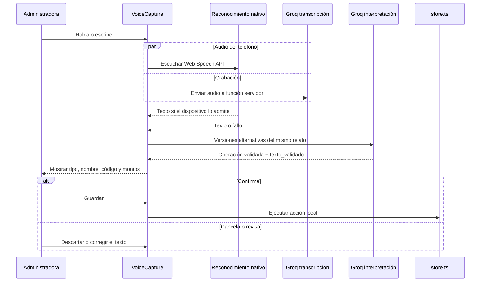
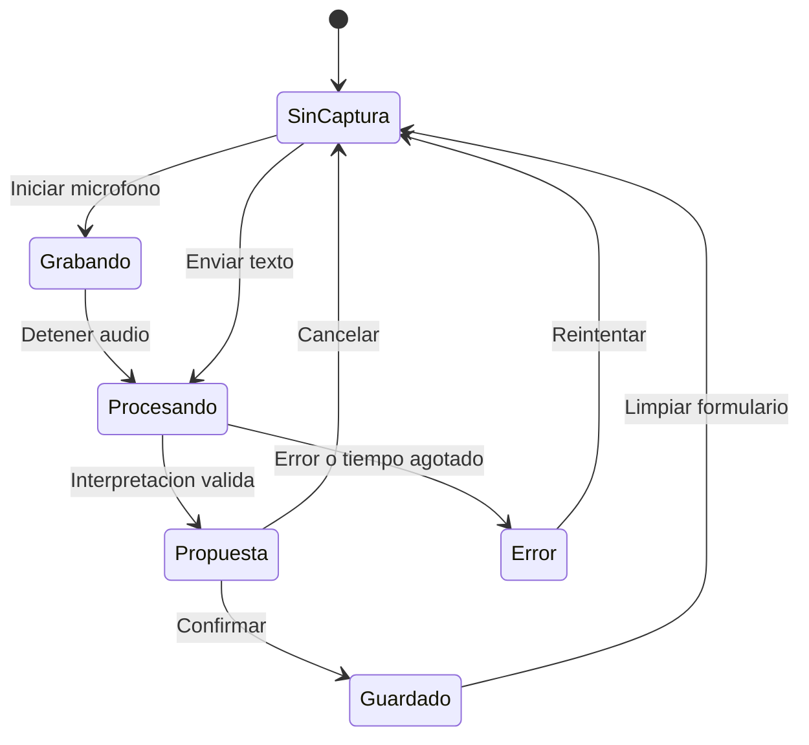
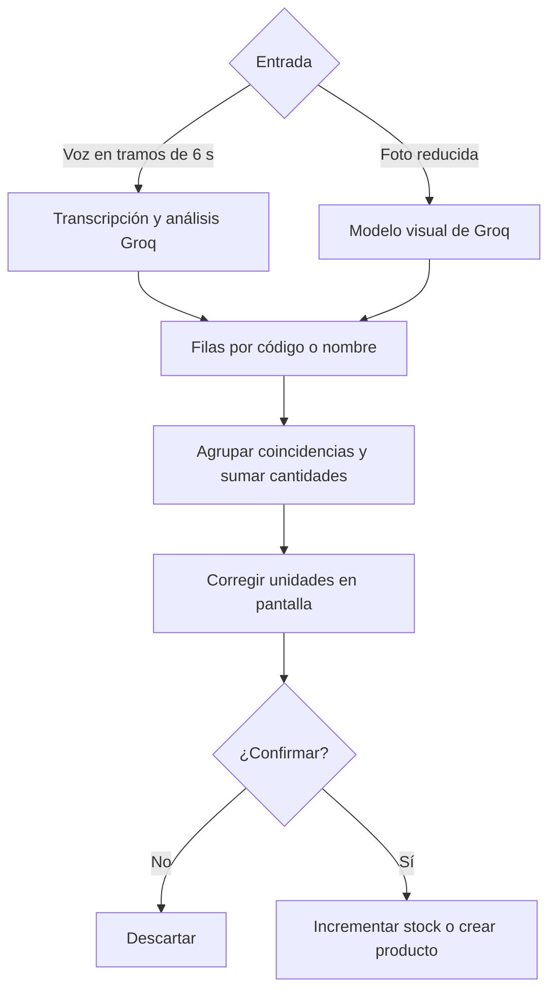

# Captura de voz, texto y fotografías

La asistencia de IA convierte una frase cotidiana en una propuesta que la persona revisa antes de guardarla. Las funciones están en [`src/lib/ai.functions.ts`](../../src/lib/ai.functions.ts) y se ejecutan en el servidor TanStack Start, con la clave de Groq fuera del cliente.

## Registro por voz o texto

`transcribirConRespaldo()` escucha ambas fuentes concurrentemente: si hay texto nativo, espera brevemente (1200 ms) por Groq; si no lo hay, puede esperar hasta 60 s. **No suma** ambas transcripciones ni ejecuta dos ventas. Si falla la llamada de interpretación, mantiene el texto disponible para revisión; no usa otro proveedor de IA de pago como fallback.

La interpretación devuelve una estructura con `tipo` (`fiado`, `abono`, `encargo`, `stock`, `otro`), `cliente`, `codigo`, `total`, `abono_inicial`, `cuotas`, `cantidad`, `nota`, `resumen` y `texto_validado`. El servidor comprueba el esquema con **Zod**. El modelo de chat configurado es `openai/gpt-oss-120b` a través de **Groq**; el audio usa `whisper-large-v3`.

## Estados de una captura

El diagrama resume la experiencia de captura. El componente la representa con `idle`, `grabando`, `pensando` y la respuesta `res`.

## Conteo de bodega por voz o foto

La foto se reduce a un tamaño máximo de 1600 px por lado y se envía como imagen JPEG. El modelo visual configurado es `qwen/qwen3.8-27b`, también por Groq. Las respuestas deben respetar una lista de productos con cantidades enteras positivas; luego la persona puede ajustar el conteo. La UI **suma** cantidades al stock existente, no reemplaza la bodega por un inventario físico reconciliado.

## Qué envía la aplicación a terceros

- Groq recibe audio grabado, texto dictado/escrito o una fotografía cuando la persona utiliza esas funciones.
- En el conteo también recibe nombres de otros productos para facilitar coincidencias.
- El generador de publicaciones envía la idea de marketing y una referencia de productos para crear **un prompt**, no la publicación final.

Las funciones limitan la longitud de texto y el tamaño de las entradas. Las credenciales se configuran en el servidor y los ejemplos de desarrollo deben usar datos ficticios.

## Revisión de resultados

La validación comprueba la estructura de la respuesta; la persona revisa códigos, cantidades, montos y fechas. Un fiado por voz descuenta actualmente una unidad si tiene código, independientemente del campo `cantidad`. Las pruebas deben incluir red lenta, permisos denegados y cierre de una captura mientras hay respuestas pendientes.

[Dominio y efectos](02-dominio-y-reglas.md) · [Casos de prueba](../desarrollo/03-pruebas-y-limitaciones.md)
