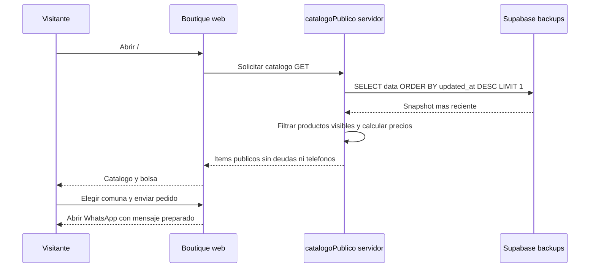

# Boutique y acceso a datos

La ruta `/` muestra la Boutique pública. Las pantallas de gestión se agrupan en Vault mediante `AppShell` y `AdminGate`, definidos en [`__root.tsx`](../../src/routes/__root.tsx). La aplicación instalada abre `/vault`.

## Consulta del catálogo

[`catalogoPublico`](../../src/lib/boutique.functions.ts) se ejecuta en el servidor con `supabaseAdmin`. Lee la fila de `backups` con la fecha `updated_at` más reciente y pasa sus productos y precios a [`aPublico()`](../../src/lib/boutique.ts).

La consulta actual selecciona el último respaldo global, sin filtrar por propietario. El uso con varias cuentas requiere vincular el catálogo a la cuenta del negocio; las consultas del cliente privilegiado omiten las políticas RLS.

## Información visible

`ItemPublico` contiene código, nombre, inspiración, versión, categoría, precio calculado, cantidad de stock, tipo y estado. La respuesta excluye deudas, cuotas, abonos y teléfonos.

Un producto aparece salvo que `enBoutique === false`, siempre que tenga stock o datos descriptivos. Los productos nuevos pueden mostrarse por defecto después del respaldo; la administradora puede cambiar su visibilidad desde Bodega.

La bolsa prepara un mensaje de WhatsApp con los productos, el total y la comuna. Las comunas disponibles son La Serena, Coquimbo, Calama y Otra. La consulta se coordina con la tienda y se registra por separado en Vault.

## Controles de acceso

| Capa                    | Responsabilidad                                                                                                                     |
| ----------------------- | ----------------------------------------------------------------------------------------------------------------------------------- |
| PIN de Vault            | Control local de acceso a las pantallas; se guarda en `localStorage`.                                                               |
| Google y Supabase Auth  | Sesión de la cuenta utilizada para respaldos y tokens push.                                                                         |
| Políticas RLS           | Restringen las filas de `backups` y `push_tokens` al usuario autenticado.                                                           |
| Proyección `aPublico()` | Selecciona los campos de producto que devuelve el catálogo.                                                                         |
| Cliente `supabaseAdmin` | Acceso privilegiado exclusivo del servidor para catálogo y recordatorios.                                                           |
| Funciones de IA         | Mantienen la clave de Groq en el servidor y validan el formato de entrada y respuesta; actualmente no aplican middleware de sesión. |

El PIN controla la interfaz del dispositivo y no sustituye la autorización del servidor. El soporte de varios usuarios requiere definir permisos para cada función, propietario del catálogo y límites de consumo de IA.

## Manejo de datos privados

Los respaldos incluyen nombres, cobros y teléfonos. Usa datos ficticios en pruebas y ejemplos; mantén las copias reales y las credenciales fuera del repositorio. Revisa el contenido de las notificaciones que pueda aparecer en la pantalla bloqueada.

[Persistencia y RLS](03-persistencia-y-sincronizacion.md) · [Próximos pasos](../desarrollo/04-evolucion.md)
