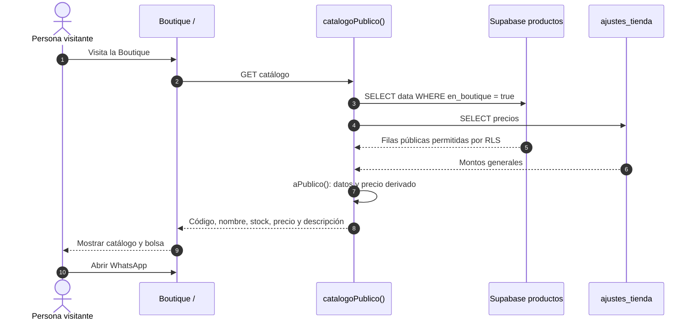
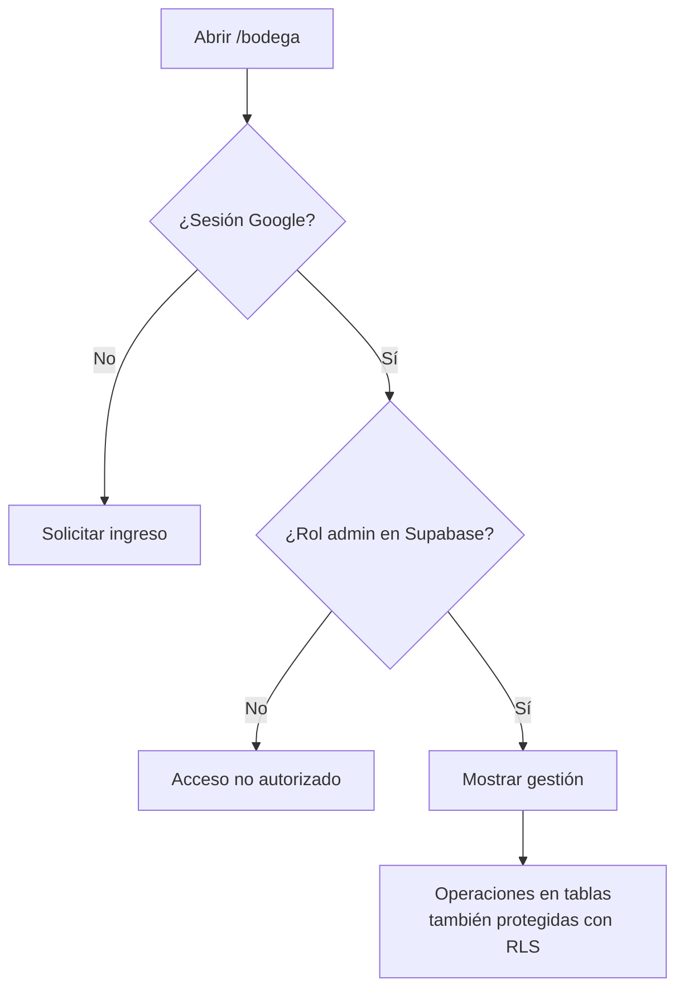

# Boutique · visibilidad, roles y límites de seguridad

[← Técnica](../README.md) · [Arquitectura](01-arquitectura.md) · [Persistencia](03-persistencia-y-sincronizacion.md)

La **Boutique** es pública. La **Bodega** administra inventario y cobros con una sesión autorizada. La separación actual se basa en **Supabase Auth + rol `admin` + políticas RLS**, no en una contraseña fija de la interfaz.

## Qué ocurre al consultar un producto

[`catalogoPublico()`](../../src/lib/boutique.functions.ts) usa una **clave publicable de Supabase** en una función de servidor, no `supabaseAdmin`. Esto hace relevantes las políticas RLS de `productos` y `ajustes_tienda`.

### Lo visible y lo privado

| Información | Boutique | Bodega / respaldo |
| --- | --- | --- |
| Código, nombre, categoría, inspiración, precio derivado, stock | Visible para productos publicados | Editable por administradora |
| Precio general de la tienda | Usado en cálculo público | Editable por administradora |
| Nombre de cliente, deuda, abono, cuota, teléfono | **No aparece en `ItemPublico`** | Forma parte de `State` y de `backups` |
| Pedidos enviados por WhatsApp | Mensaje fuera de la web | Se registran manualmente como encargo o venta |

Los productos se publican por defecto si no están marcados `enBoutique === false` y cumplen el filtro de `aPublico()`. El control de visibilidad existe en la pantalla de stock; conviene comprobarlo antes de agregar un artículo nuevo.

## Administración y primera cuenta

1. La ruta `/bodega/*` usa `AdminGate`, que solicita iniciar sesión con Google y consulta `esAdmin()`.
2. `esAdmin()` llama a `has_role` con el usuario autenticado. Las operaciones de escritura en `productos` y `ajustes_tienda` se restringen además mediante RLS.
3. La migración `0001_productos_y_admin.sql` instala `primera_admin()`, que asigna el rol al **primer usuario creado cuando aún no existe un admin**. La instalación debe verificar que esa primera cuenta sea la prevista antes de habilitar registros.
4. Los respaldos y tokens push tienen RLS ligado a `auth.uid() = user_id`.

La protección de la interfaz no es suficiente por sí sola: los permisos del servidor y la base deben comprobarse con distintos roles y peticiones directas.

## Seguridad pendiente de validar

- **Bootstrap de admin:** comprobar que la cuenta propietaria sea asignada de forma deliberada y revisar cómo se recupera o revoca su rol. No se presume verificado el estado de la instancia desplegada.
- **Datos públicos:** inspeccionar la respuesta real de `catalogoPublico()` y las reglas de `productos.data` con un usuario sin sesión.
- **Privacidad:** evitar que un respaldo completo con nombres o teléfonos se registre en logs, notificaciones o datos de ejemplo.
- **Asistencia Groq:** las funciones de `ai.functions.ts` validan entradas, pero no se observa un middleware de sesión en esas rutas. Revisar autorización, cuotas y exposición de datos antes de publicar un servicio abierto.
- **Multidispositivo:** validar que una edición no sobrescriba otra al recibir Realtime o restaurar el snapshot.

**No se afirma haber resuelto estas cuestiones en este PR**: son riesgos identificados para comprobación técnica con un entorno de prueba.

[Datos y RLS](03-persistencia-y-sincronizacion.md) · [Pruebas pendientes](../desarrollo/03-pruebas-y-limitaciones.md) · [Migración de roles](../../drizzle/migrations/0001_productos_y_admin.sql).
