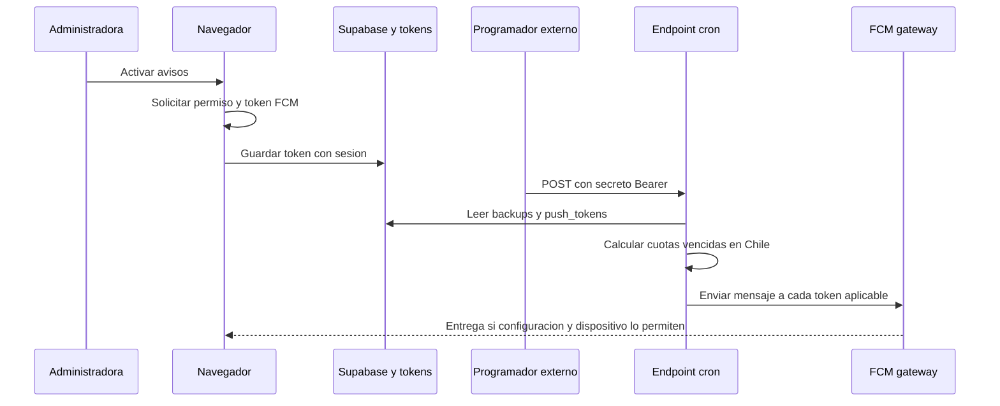

# Recordatorios y notificaciones

PaMaRa Bodega ofrece avisos locales mientras la aplicación está abierta y notificaciones web push programadas.

## 1. Aviso local con la aplicación abierta

[`AppShell.tsx`](../../src/components/AppShell.tsx) detecta cuotas vencidas o que vencen hoy mientras la parte administrativa se encuentra montada. Si el navegador ya concedió permisos, genera una notificación y marca en `localStorage` que avisó ese día (`pamara-aviso`). Este comportamiento **no garantiza** que aparezca una alerta con la aplicación cerrada.

## 2. Avisos web push programados

El navegador solicita permiso desde Ajustes, registra Firebase Messaging y envía un token a la función de servidor `savePushToken`. La función exige sesión Supabase y lo guarda en `public.push_tokens`.

La ruta [`/api/public/jobs/recordatorios`](../../src/routes/api/public/jobs/recordatorios.ts) verifica un secreto de cron en las solicitudes `POST`. El servidor usa el gateway de Lovable para FCM. El service worker está en [`public/firebase-messaging-sw.js`](../../public/firebase-messaging-sw.js).

## Límites y verificación

- Configura Firebase Web Push y una tarea externa que invoque el endpoint; comprueba ambos servicios antes de habilitar los avisos para uso diario.
- La fecha del cobro se evalúa mediante `America/Santiago`. La programación diaria de referencia es **13:00 UTC**; la hora local varía con el horario de verano e invierno de Chile y debe revisarse en el programador externo.
- Se eliminan tokens si FCM responde 400/404, pero la entrega y lectura dependen del servicio, navegador y permisos.
- Las notificaciones pueden contener nombres y montos de deudas; probar la exposición de contenido en la pantalla bloqueada con datos sintéticos y permiso expreso.

Comprueba la recepción de un aviso con la aplicación cerrada en el teléfono de uso y en el horario esperado.

[Prueba Android](../android-acceptance.md) · [Pruebas de integración](../desarrollo/03-pruebas-y-limitaciones.md)
